<!-- Hand-maintained profile README (no longer generated from a template). The full event calendar lives in CommunityActivities.md. -->

### Hi, I'm Paco 👋

**Kubernetes** — [Steering Committee](https://github.com/kubernetes/steering) · [kubeadm](https://github.com/kubernetes/kubeadm/) maintainer · [SIG Node](https://github.com/kubernetes/community/blob/main/sig-node/README.md)/[Scheduling](https://github.com/kubernetes/community/blob/main/sig-scheduling/README.md) reviewer 
**CNCF** — [TAG Workloads Foundation](https://github.com/cncf/toc/tree/main/tags/tag-workloads-foundation) Chair · [Ambassador](https://www.cncf.io/people/ambassadors/?_sft_lf-country=cn&p=paco-xu&_sf_s=paco+xu) 
**DaoCloud** — open source team ([DCE](https://www.daocloud.io/products/index.html), [d.run](https://d.run/)) 
Past: [KubeCon China 2024](https://events.linuxfoundation.org/archive/2024/kubecon-cloudnativecon-open-source-summit-ai-dev-china/) Co-Chair · KubeCon NA 2024 & EU 2025 Track Chair · [LFAPAC Evangelist](https://evangelists.linuxfoundation.cn/evangelists) 2024/25

- 🔭 **Now:** AI infra & LLM inference ([vLLM](https://github.com/vllm-project/vllm)) · DRA & [Agent Sandbox](https://github.com/kubernetes-sigs/agent-sandbox) · Kubernetes performance — notes in [AI-Infra](https://github.com/pacoxu/AI-Infra)
- 🎙️ **Talks:** next at [KCD Hangzhou](https://sessionize.com/view/9wf3k38o/GridSmart?format=Embed_Styled_Html&isDark=False&title=KCD%20Hangzhou%202026), Nov 28 (agent-sandbox → Dynamic Containers) · recently at [KubeCon NA 2026](https://events.linuxfoundation.org/kubecon-cloudnativecon-north-america-2026/) (Steering AMA, TAG Workloads)
- 📚 **More:** [events & talks](https://github.com/pacoxu/pacoxu/blob/master/CommunityActivities.md) · [videos](https://www.youtube.com/playlist?list=PLROmsd5kH8pBiN0Km1EepbzKoDiM5S6Ok) · [blog](https://github.com/pacoxu/pacoxu/blob/master/blog-list.md) · [RSS](https://raw.githubusercontent.com/pacoxu/pacoxu/master/feed.xml)

<a href="https://www.cncf.io/people/ambassadors/?_sft_lf-country=cn&amp;p=paco-xu&amp;_sf_s=paco+xu">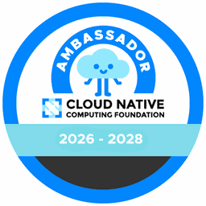</a>
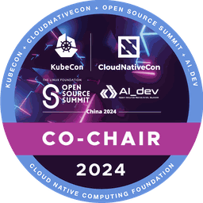
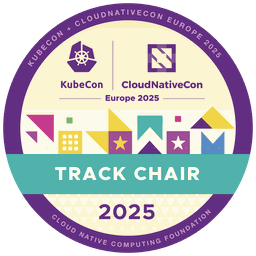
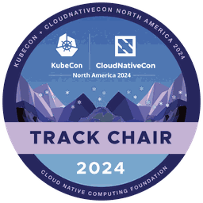
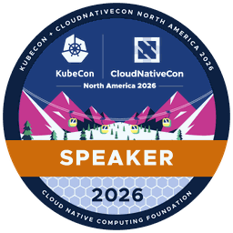
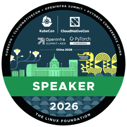

More badges: speaker · program committee · LF

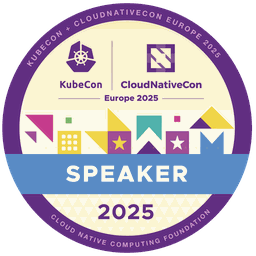
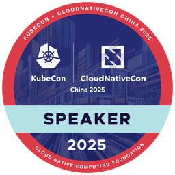
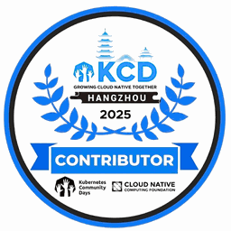
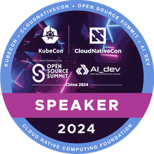
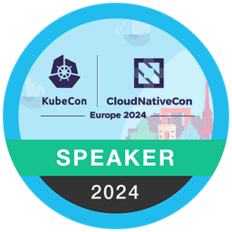
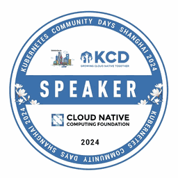
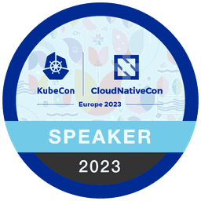
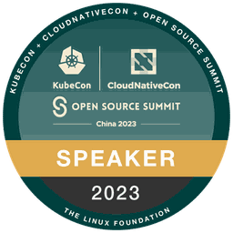
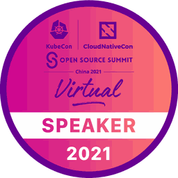
 
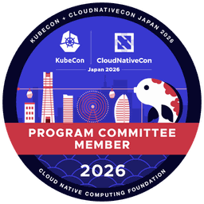
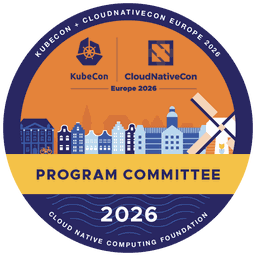
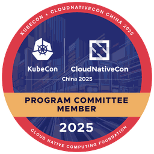
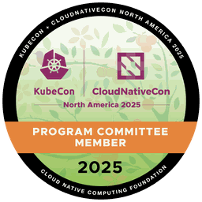
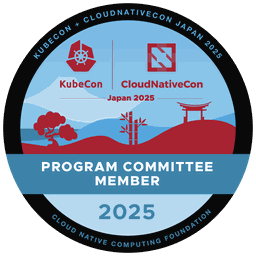
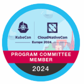
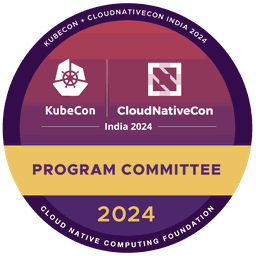
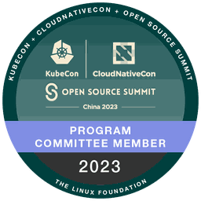
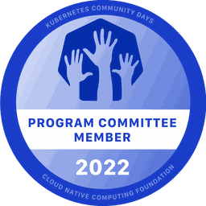
 
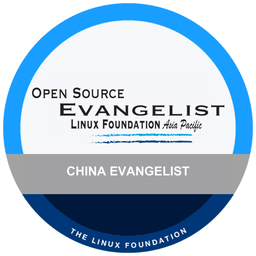
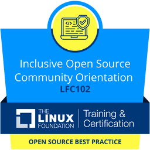

🇨🇳 *The only thing that I know is that I know nothing.*
